#### 🎯 Focus

#### 🔁 How I ship

#### 🚀 Live on GitHub Pages

Live status checked on each site · click a badge for the source code

#### ⚙️ DevOps & Cloud

#### 🛡️ Security

 

🔒 *"Security is not a product, but a process."* — Bruce Schneier

<!---
MHChlagou/MHChlagou is a ✨ special ✨ repository because its `README.md` (this file) appears on your GitHub profile.
--->
